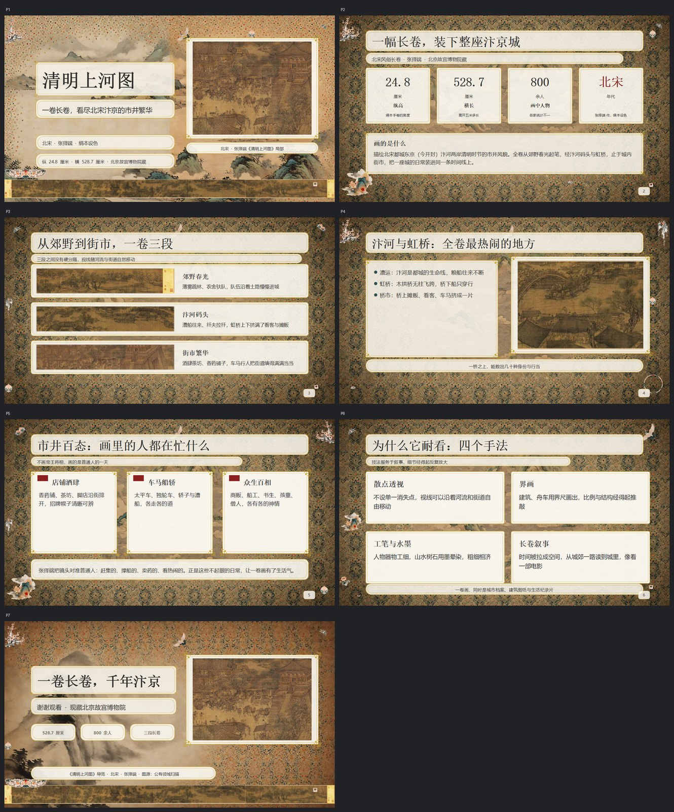
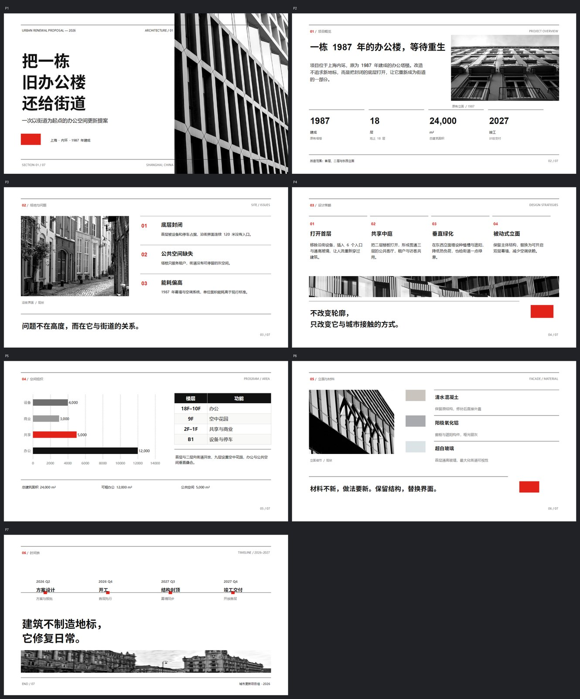

<div align="center">

# dsh-pptx-studio

**Design-first PowerPoint generation for DeepSeek Harness**

给一个主题，得到一套可编辑、版式完整、配图统一的 PPT。

[](https://github.com/ColdMagicchess/PTT-Studio)
[](tests)
[](LICENSE)
[](package.json)

[功能](#功能) · [示例](#示例) · [安装](#安装) · [使用](#使用) · [工具](#工具) · [开发](#开发) · [Roadmap](#roadmap)

</div>

---

## 为什么是它

大多数 AI PPT 工具做的是「把文字塞进模板」：页页一样、图是贴纸、导出后全是图片。
`dsh-pptx-studio` 走的是另一条路：**先把每一页当设计稿画出来，再用确定性代码组装**。

- **先设计，再生成**：先产出可审阅的 `deck.json`（版式、网格、层级、配色、图片位置），再渲染成 PPT。
- **满版构图**：内置覆盖率检查，极简也要撑满版面，拒绝「上半页内容 + 下半页空白」。
- **真实素材优先**：名画、文物、地标、产品先用公有领域/授权原图，AI 只补没有现成素材的插画、背景和装饰。
- **确定性组装**：pptxgenjs 按百分比坐标绘制，文字、形状、图表、表格、图标全部是原生可编辑元素。
- **自带质检**：溢出、重叠、安全区、文字密度、对比度、装饰压字、版面覆盖率、背景采样，逐项检查后再交付。
- **图片不重复嵌入**：同一张背景/装饰只存一份，配合 800px 级图片压缩，成片通常在 1–4 MB。

## 示例

以下都是插件真实生成的成片（点击预览图查看大图）：

| 编程夏令营 · 扁平插画 / rich | 清明上河图导览 · 水墨 / ornate | 旧办公楼更新 · 瑞士极简 / minimal |
|---|---|---|
| [](docs/preview/camp.jpg) | [](docs/preview/qingming.jpg) | [](docs/preview/swiss.jpg) |
| 7 页 · 3 背景 + 6 张 cutout 插画 + 10 件装饰 · 2.9 MB | 7 页 · 公有领域原作裁段 + 12 件水墨装饰 · 3.7 MB | 7 页 · 黑白建筑摄影 + 严格网格 + 信号红 · 650 KB |

> 三份成片均为 `pptx_build` 0 error 产物；预览由 LibreOffice 渲染。

## 功能

### 设计系统

- **11 套风格**：扁平插画、科技深色、国风水墨、瑞士国际主义、复古印刷、手绘、3D 等；
- **5 档复杂程度**：极简 / 简约 / 均衡 / 复杂 / 华丽；
- **3 档文字量**：字少多图、均衡、字多图少；
- **17 种版式**：封面、章节、要点、对比、时间线、数据、图表、表格、引用、图片全屏、结尾等；
- 统一网格、字号阶梯、留白与安全区规则，生成前先看 `assets/pptx-studio/references/styles.md`。

### 素材生成

- 风格板：一次生成 2–3 张候选封面构图，用户选定后作为插画风格参考；
- 背景 / 插画 / 装饰件分开生成：背景只画底子，装饰件按组生成后切成透明 PNG；
- 插画默认 **cutout 去底**，直接融入背景，不套白框；
- 插画可带风格参考图；纯背景与装饰件不参考人物图，避免把角色抄进背景；
- 支持 Agnes AI（默认）与 ModelScope（Qwen-Image）两种图片后端，带缓存、重试、限流；
- 真实素材优先：支持 `path` 直接引用本地图片，并记录来源与许可。

### 生成与质检

- `pptx_build` 组装可编辑 `.pptx`：文字、形状、原生图表、轻量表格、矢量图标、装饰件、页码；
- `pptx_check` 检查溢出、重叠、安全区、密度、对比度、`fill` 覆盖率、装饰压字、背景纹理采样；
- `pptx_review` 用配置的独立视觉模型逐页评审渲染图，返回结构化的版式 / 字号 / 对比度 / 配图问题；
- `pptx_render` 用 LibreOffice Kit 渲染逐页 PNG，交给对话模型做视觉复查；
- `pptx_build` 默认生成逐页缩略图和总览图 `<文件名>.preview.jpg`，交付时一起给出；
- `pptx_generate_assets` 支持 `run_in_background`：图片多时立即返回 job id，模型继续写后面的页，最后用 `job_output` 收结果。

### 插件集成

- 注册 `pptx-studio` skill：模型按「问需求 → 写 deck → 生成素材 → 组装 → 检查」流程执行；
- **聊天卡片**：6 个 `pptx_*` 工具在 Web 对话里显示专用卡片——组装卡带总览图、页数、体积与问题，评审卡逐页结论，配图/样张/渲染卡显示缩略图网格，点击可放大；
- 插件设置页：文字 / 图片 / 视觉三类模型，自定义 OpenAI 兼容模型，API Key 写入 DSH 凭据库；
- 文字与视觉模型默认跟随当前对话；图片模型默认 Agnes；
- 兼容 DSH Desktop 0.2.1-rc.2 及以上（`engines.dsh: >=0.2.1-rc.2 <0.3.0`）。

## 工作流

```text
主题
  │
  ├─ ask_user_question → brief.json        风格 / 复杂度 / 文字量
  ├─ 逐页设计稿 → deck.json                版式、元素、坐标、文案
  ├─ pptx_style_board → style/board-N.png  候选风格构图（用户选定）
  ├─ pptx_generate_assets → assets/ decor/ 背景、插画、装饰件
  ├─ pptx_build → builds/deck.vN.pptx      确定性组装 + 几何检查
  ├─ pptx_check / pptx_render              文字、对比度、覆盖率、逐页目检
  └─ present                              交付 .pptx
```

每一步的产出都落在工作区文件里，模型只通过工具结果和文件看到内容；中途可以随时改 `deck.json` 重新组装。

## 安装

### 环境要求

- DeepSeek Harness Desktop **0.2.1-rc.2** 或更新的 0.2.x（0.3 尚未适配）；
- Node.js **≥ 22.19**（仅从源码构建时需要）；
- 图片生成需要 Agnes 或 ModelScope 的 API Key。

### 从插件市场安装（推荐）

本仓库自带一份 DSH 插件市场索引（[market/index.json](market/index.json)，格式 1，已用 DSH 官方校验器验证）：

1. 打开 **插件** → **实验性插件** 旁的 **更多** → 打开 **自定义插件市场**；
2. 切到 **发现** → **添加索引源**，填入 `https://raw.githubusercontent.com/ColdMagicchess/PTT-Studio/main/market/index.json`；
3. 搜索 “PPT”，点 **安装**。每个版本锁定到一个提交，无需构建授权。

### 直接从 GitHub 安装

本仓库按 DSH **组合包（bundle）分发格式**组织，并且已经把构建产物提交在 `lib/` 下，因此不需要在安装时构建：

```bash
dsh plugin --profile desktop add github:ColdMagicchess/PTT-Studio
```

安装后重启 Desktop，在「插件」页看到 **PPT 工作室** 即成功。生产环境建议锁定 commit：

```bash
dsh plugin --profile desktop add github:ColdMagicchess/PTT-Studio#<commit>
```

### 从源码构建 tgz

```bash
git clone https://github.com/ColdMagicchess/PTT-Studio.git
cd PTT-Studio
pnpm install
pnpm run build
pnpm run pack
```

然后在 Desktop 中二选一：

1. 打开「插件」页 → 安装第三方插件 → 选择 `dist/dsh-pptx-studio-0.4.0.tgz`；
2. 或退出 Desktop 后，用自带 CLI 安装：

```powershell
"E:\Deepseek harness Desktop\resources\runtime\cli\bin\dsh.cmd" plugin --profile desktop add "E:\path\to\dist\dsh-pptx-studio-0.4.0.tgz"
```

重启 Desktop，插件页出现 **PPT 工作室** 即安装成功。

> 如果修改了源码，重新执行 `pnpm run build` 后把 `lib/index.js`、`lib/client.js` 一起提交；DSH 从 GitHub 安装的是仓库内容，不会替你运行构建脚本。

### 配置 API Key

打开「插件 → PPT 工作室」设置页，在 **API Key** 分区填入：

- `AGNES_API_KEY`：Agnes AI 国内站（默认图片后端）；
- `MODELSCOPE_API_KEY`：ModelScope（可选备用后端）；
- 自定义模型 Key：按自定义模型的 `apiKeyRef` 填写。

Key 只写入 DSH 凭据库，不进入配置文件。也可以直接设置同名环境变量后重启 Desktop。

## 使用

安装后在对话里直接说：

> 做一份关于「青少年编程夏令营」的招生 PPT，风格活泼一点，文字少一些。

> 做一份「旧办公楼更新提案」，现代极简、商务建筑风，7 页左右。

模型会自动加载 `pptx-studio` skill，按顺序完成需求确认、设计稿、风格板、配图、组装和检查。如果插件设置里配置了独立视觉模型（`visionModelMode` 为 `route` 或 `custom`），检查阶段会调用 `pptx_review` 逐页评审并返回结构化问题；默认 `session` 时仍用渲染图 + `read_image` 复查。你也可以在过程中直接指定：

- 「用瑞士国际主义风格，黑白摄影 + 信号红」
- 「这块内容太空了，补满一点」
- 「插画不要白边，直接融进背景」
- 「第 5 页文字太小，投影看不清」

## 工具

| 工具 | 作用 |
|---|---|
| `pptx_style_board` | 生成 2–3 张候选风格样张，供用户选定 |
| `pptx_generate_assets` | 生成背景、插画、装饰件；支持 `run_in_background` 后台任务与进度 |
| `pptx_build` | 按 `deck.json` 组装 `.pptx`，内置几何检查与媒体去重 |
| `pptx_check` | 检查溢出、重叠、安全区、密度、对比度、覆盖率和装饰压字 |
| `pptx_review` | 用独立视觉模型逐页评审渲染图，返回结构化问题与修复建议 |
| `pptx_render` | 用 LibreOffice Kit 逐页渲染 PNG，做视觉复查 |

配套 skill：[`assets/pptx-studio/SKILL.md`](assets/pptx-studio/SKILL.md)；版式与风格参考在 [`assets/pptx-studio/references/`](assets/pptx-studio/references/)。

## 配置

所有可调参数都在插件 `Config` 中（`src/config.ts`），可在 profile 的 `cordis.patch.yml` 覆盖；设置页编辑下列字段：

| 字段 | 默认值 | 说明 |
|---|---|---|
| `textModelMode` / `textModelName` | `session` / 空 | 文字模型：跟随对话、Host 路线或自定义模型 |
| `visionModelMode` / `visionModelName` | `session` / 空 | 视觉模型：`pptx_review` 用它逐页评审 |
| `imageBackend` | `agnes` | 当前图片后端；内置 `agnes`、`modelscope` |
| `imageBackends` | Agnes + ModelScope | 图片后端列表（名称、模型、Base URL、Key 引用） |
| `customModelsJson` | `[]` | 自定义 OpenAI 兼容模型数组 |
| `customModelApiKeyRef` | `CUSTOM_API_KEY` | 自定义模型 Key 的凭据名 |
| `imageMaxPx` | `800` | 嵌入图片的最长边（控制包体大小） |
| `maxImagesPerCall` | `24` | 单次生成图片上限 |

## 插件仓库格式

本仓库遵循 DSH 第三方组合包的标准分发布局（单插件仓库）：

```text
package.json          name / version / main / exports / files / engines.dsh
                      dsh.bundle.patch → cordis.patch.yml
                      dsh.client       → lib/client.js（Web 设置页）
cordis.patch.yml      bundle 层：插入一个 id 为 pptx-studio 的 Host 行
lib/index.js          Host 入口（已提交，安装即用）
lib/client.js         Web 设置页（已提交）
locale/               插件页标题与描述
assets/pptx-studio/   skill、风格/版式/生图/质检规范
src/                  TypeScript 源码（开发用）
```

`package.json` 的 `files` 精确包含发布需要的文件；`lib/` 是构建产物但**必须入库**，因为 `dsh plugin add github:...` 只拉源码、不运行 `prepare`/构建脚本。

## 项目结构

```text
assets/pptx-studio/   skill、风格/版式/生图/质检规范与 schema
src/
  index.ts            插件入口、skill 注册
  config.ts           Config schema（设置页字段标记 volatile）
  client/             插件设置页（构建为 lib/client.js）
  deck/               deck.json 校验与类型
  build/              pptxgenjs 组装、媒体去重、坐标换算
  images/             图片后端、提示词、风格板、装饰件切割
  check/              几何/对比度/覆盖率检查
  tools/              6 个模型工具与沙箱写入
  types/host.d.ts     DSH Host API 的最小类型声明
tests/                vitest 单元测试（137 个）
scripts/              端到端与单 deck 开发脚本
docs/                设置页设计与预览图
market/              插件市场索引（格式 1）与图标
.github/workflows/   CI 校验与 Release 打包
```

## 开发

```bash
pnpm install
pnpm run typecheck
node_modules\.bin\vitest.cmd run   # 无 TTY 环境下 pnpm exec 会 purge node_modules
pnpm run build                     # lib/index.js + lib/client.js
```

- `scripts/e2e-bundle.ts`：用模拟宿主加载 `lib/index.js`，跑 check/build 与沙箱拒绝；
- `scripts/deck-pipeline.ts <style|generate|check|build|render> <deck.json>`：不经过 Host 直接迭代单份 deck；
- `scripts/e2e-full.ts <deck> <工作目录> <封面主体>`：完整「风格板 → 素材 → 组装」，需要 `AGNES_API_KEY`；
- 测试覆盖 deck 校验、组件布局、图片裁剪/切件、装饰件、覆盖率、沙箱、后台任务和设置字段。

> 开发时宿主包通过 `.host/` 的 junction 链接到 `node_modules/@deepseek-ai/`，仅用于本地测试。复制仓库后如果 junction 失效，按 `scripts/link-host.ps1` 重建。

## Roadmap

- [x] Phase 1–4：规范、技术验证、组装/检查、配图与装饰件
- [x] Phase 4.5：满版、去白框、装饰件物理比例、媒体去重
- [x] Phase 5：生图后台任务、模型设置页与 Key 输入
- [x] Phase 6：独立视觉模型逐页评审（`pptx_review`）
- [x] Phase 7：Web 体验（工具卡片、PPT 总览图预览、交付缩略图）
- [x] Phase 8：插件市场发布（[market/index.json](market/index.json) + GitHub Release 工作流）

## 说明

- 本插件不新增 Session 事件；所有产出通过工具结果和工作区文件传递，避免历史会话不可重开。
- 宿主提供的 `@deepseek-ai/cordis`、`dsh-tools`、`dsh-credentials` 不打进 bundle，其余依赖内联到 `lib/index.js`。
- 示例中的清明上河图裁段来自公有领域原作扫描图；瑞士风照片来自 Pixabay 免费商用素材。

## License

MIT © 2026 ColdMagicchess
